# rhogov user guide

[rhogov](https://rchain-community.github.io/rhogov/#/) helps a group of people decide things together on RChain. You can vote,
hand your vote to someone you trust, vouch for each other, hold each other to
account, send each other messages, and run decisions across several kinds of
stakeholders. Everything is recorded on the blockchain, and no administrator
sits in the middle.

This guide walks through rhogov the way you'll meet it. You don't need to know
anything about blockchains to follow it.

[Click here](https://rchain-community.github.io/rhogov/#/join?c=eyJuYW1lIjoiY29sYWIiLCJub2RlIjoiaHR0cHM6Ly9wbGF5Z3JvdW5kLnJob2JvdC5uZXQiLCJpbmJveCI6InJobzppZDpwNHdxN29xdGViNWdwN280Y3I4bjN1Y3E3bWNyOWRkZ2F5Z2ttZXd1cG1qM2d5Y3B3ZmFvIiwiZ3JvdXAiOiJyaG86aWQ6bzh3cmg5azVicG9kcmZyank3ajRkeG1pcmNtcXQ3ZTZkOXBxZXV0dWQ2ZGI1Y3hhZ3l5byIsImlzc3VlIjoicmhvOmlkOjR4ZGpzd2d3NjNuaHF0Nmo2cHF1cnlxN2d1czduM2ltemRubnpmY3gzNzVldWpzaHlwN28ifQ) to join the [RhoVision community](https://opencollective.com/rho-vision-community) rhogov on the rholang playground.

**Contents**

1. [Getting started](#1-getting-started)
2. [Communities and invitations](#2-communities-and-invitations)
3. [Groups](#3-groups)
4. [Voting](#4-voting)
5. [Delegating your vote](#5-delegating-your-vote)
6. [Trust](#6-trust)
7. [Censure](#7-censure)
8. [Inbox](#8-inbox)
9. [Councils: decisions across stakeholder groups](#9-councils-decisions-across-stakeholder-groups)
10. [Your account and your key](#10-your-account-and-your-key)
11. [What is public, and what it costs](#11-what-is-public-and-what-it-costs)
12. [Troubleshooting](#12-troubleshooting)
13. [Glossary](#13-glossary)

---

## 1. Getting started

Open [rhogov](https://rchain-community.github.io/rhogov). The first screen walks you through three short steps.

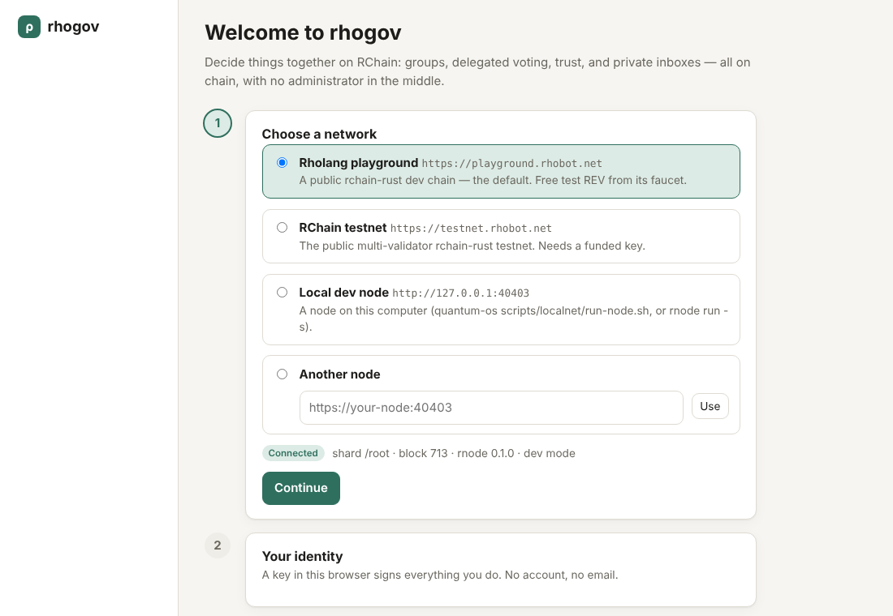

**Step 1: choose a network.** A network is the blockchain your community uses.
The **Rholang playground** is selected for you. It's free, it hands out test
money, and it's the right place to start. The **RChain testnet** works the same
way and is the shared public test network. Pick another node only if your
community told you to.

**Step 2: your identity.** Type the name you'd like others to see, then press
**Continue**. rhogov creates a *key* for you in your browser. The key is your
identity: it signs everything you do, and it never leaves your device. There's
no account, no email and no password. (Already have an RChain key? Choose **I
have a key** and paste it, or choose its keystore file and type its password.)

Once your key exists you'll see your balance. On the playground or the testnet,
press **Get test REV**. A moment later you'll have enough to act. (The testnet
faucet is the same one in [r-wallet](https://rhowallet.org), the RChain web
wallet, so you can also use it from there.) Every action costs a tiny fee,
paid in REV (see [section 11](#11-what-is-public-and-what-it-costs)).

**Step 3: join or start a community.** If someone sent you an invite link,
paste it and press **Join community**. Otherwise choose **Start a new community**
(next section).

Then you land on **Home**. It opens with what rhogov is for, and says what needs you
now: votes waiting for your ballot, invitations, new messages. A community with
nothing in it yet says so, and offers the first thing to do — a group — rather than
telling you that you're all caught up. Everything in rhogov happens inside a group:
who belongs, what they decide, and how much each vote weighs.

> **Back up your key** (Account → Save keystore file) once you've set up. If you
> clear your browser's data without a backup, that identity is gone.

## 2. Communities and invitations

A **community** is everyone who uses the same set of governance contracts on the
same network. A community can hold any number of groups and councils.

**Starting one.** Give it a name and press **Start community**. rhogov installs
three small contracts with your key (Inbox, Group and Issue), which takes a few
seconds. Installing them gives you no special power: you're an ordinary member
like everyone else.

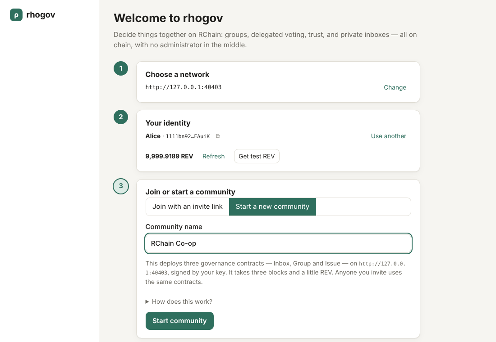

**Inviting people.** Go to **Community** and copy the invite link. Send it any
way you like. It holds only the network address and the contract addresses,
nothing secret. Whoever opens it is asked only for a name and a key (the invite
already says which network and community), then lands straight in the community.

**An invite to a network you didn't choose.** An invite can name any network
address. If it isn't one of rhogov's networks, one you picked yourself, or one a
community of yours already uses, the invite page says so prominently: everything
you do in that community would be signed and sent there. You have to tick "I
recognise this network…" before going on. Only do so if you trust whoever sent it.

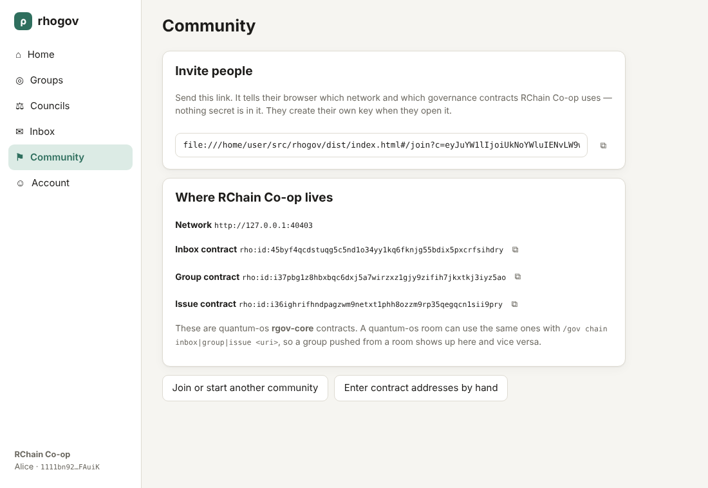

You can belong to several communities; switch between them on the **Community**
page.

The same page has a closed section, **Where it lives, and entering contracts by
hand**, holding the network address and the three contract addresses. You only
need those to wire rhogov to a quantum-os room (`/gov chain inbox|group|issue`),
or to add a community by pasting addresses instead of opening an invite.

## 3. Groups

A **group** is a set of people who vote together. Open **Groups** to see the
groups you're in and the others in the community.

**Create a group** with **＋ New group** and choose who can join:

- **Open**: anyone in the community can join.
- **Invite only**: an admin invites people, and they join when they're ready.

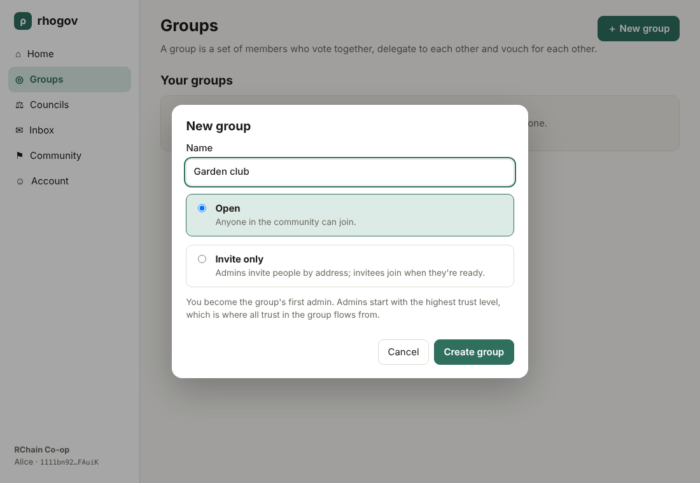

Wherever you choose a person (inviting, messaging, delegating, finding a member),
start typing their name: the names that start with what you've typed are offered.
Typing a number instead looks for an address. Someone can be found by name once their name is
on the community's list, which happens by itself with one small deploy once they
have a little REV. Until then their Home page says "Others can't find you by
name yet", with a **Get test REV** button where the network has a faucet.

Whoever creates a group is its first **admin**. Admins can invite people (with
an optional message to their inbox) and make other members admins. To invite
someone, start typing their **name** and pick it from the names offered
or paste their **REV address**. An address works even for someone who isn't in
the community yet; a name must belong to exactly one person here. Admins have
no extra say in votes, apart from the trust they start with
([section 6](#6-trust)).

A group's page has three tabs: **Votes**, **Members**, and **About** (its
settings, and **Leave group**).

## 4. Voting

Open a group and press **＋ New vote**. Write the question, add at least two
options, and choose how people vote:

- **Approval**: tick every option you're happy with. The option with the most
  support wins.
- **Ranked choice**: put options in order of preference. If no option has a
  majority, the last-placed option is removed and its votes move to each voter's
  next choice, until one wins (an *instant runoff*).

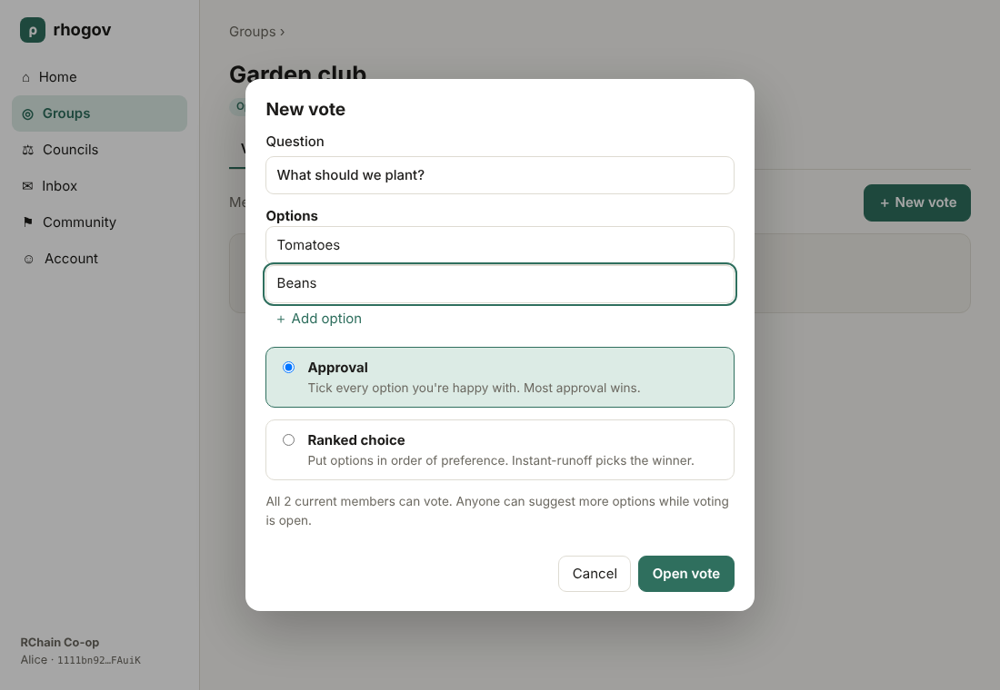

Everyone who was a member when the vote opened can vote. You can change your
vote any time until voting closes. Anyone can **suggest another option** while
it's open.

**Results.** The **Standing so far** panel shows each option's support and the
current leader. The node itself does the counting: nobody (not the person who
opened the vote, not this app) tallies votes by hand. Open **Who voted, and with
what weight** to see each ballot and how much it counts for.

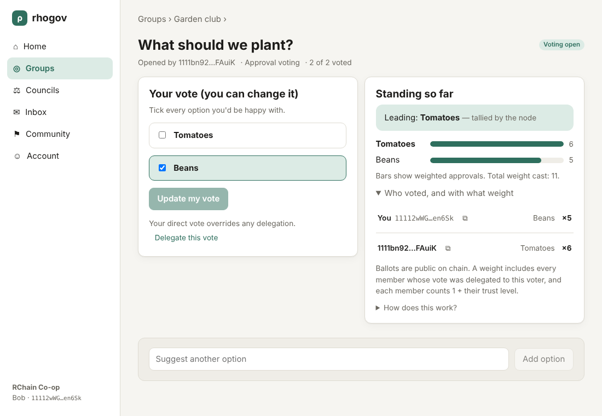

**Closing.** Whoever opened the vote can **Close voting and record result**. The
result is saved on chain under their name together with the weights the node
tallied it over, and a badge showing whether it **matches the node's tally**.

Only the ballots freeze when a vote closes. Trust, disputes and delegations keep
moving, so the node's tally can read differently later with nothing having been
tampered with — the record is the node's answer at the moment it closed, over the
weights kept with it, and that is what decided. A "reads differently now" badge is
not evidence of tampering.

**Joined late?** If you joined a group after a vote opened, you're not among the
people it's open to yet. The person who opened it sees an **Add N new members to
the vote** button. Who a vote is open to can be changed while it's open; ballots
already cast are not re-weighed.

## 5. Delegating your vote

Can't follow every decision? **Delegate** your vote to someone you trust:

- On a group's **Members** tab, press **Hand my vote to someone** to choose a
  delegate for *every* vote in that group. The same card tells you how many
  individual votes you've handed over separately, and where to change them.
- On a single vote, press **Hand this vote to someone** to choose someone for
  *just that vote*. It overrides your usual delegate there.

How it works:

- If you don't vote, your vote goes to your delegate.
- If your delegate doesn't vote either, it passes on to *their* delegate, and so
  on.
- **Voting yourself always wins.** Your own ballot replaces your delegation for
  that vote.
- A delegation that loops back on itself is ignored, and those votes aren't
  counted.

You can **take it back** at any time.

## 6. Trust

Votes can be weighted by **trust**, so people the group trusts more count for a
little more. Trust starts at zero for everyone, which means **one person, one
vote**, until someone rates someone.

- Admins start at the top level, **5**.
- On the **Members** tab, press **Rate** next to someone and pick a level from
  0 to 5.
- **You can give at most one level below your own.** Two newcomers can't vouch
  each other up; trust flows down from the admins.
- Each vote counts for **1 + the voter's trust level**.

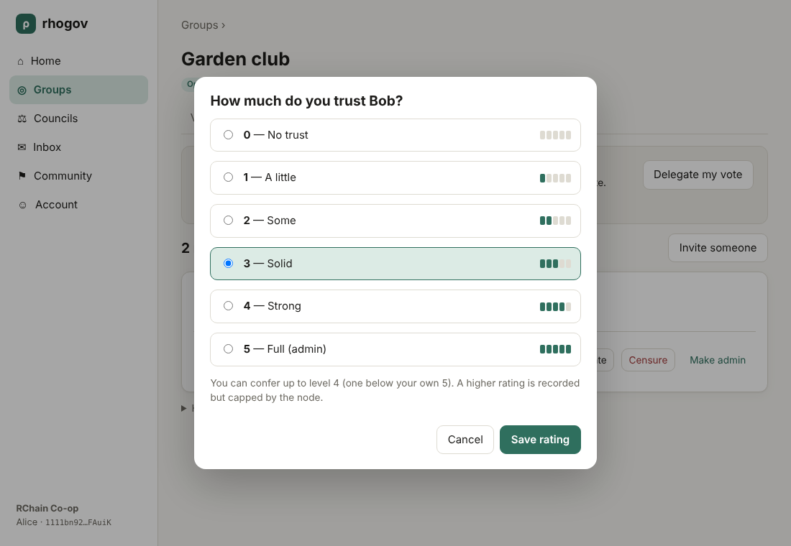

The Members tab shows each person's level as small bars, who they vote through,
and how many votes they carry for others.

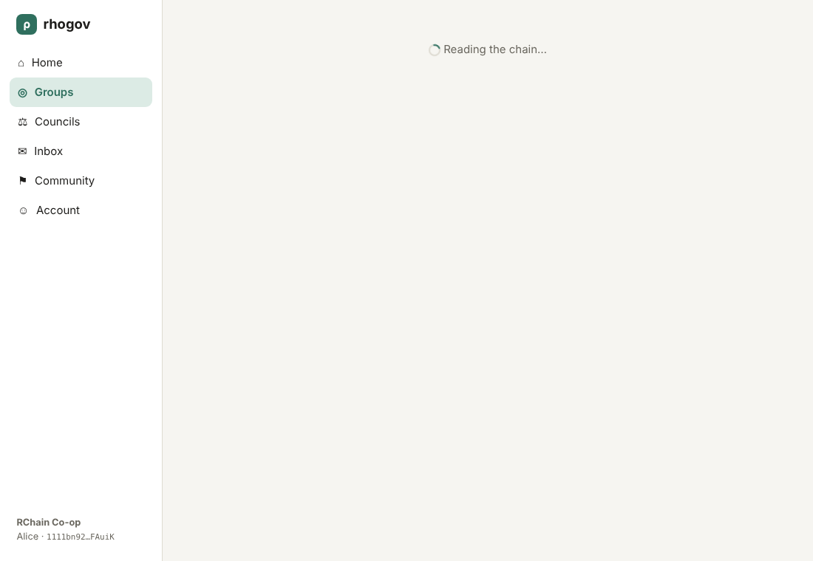

## 7. Censure

Trust can be withdrawn. If you think someone's trust is undeserved, press
**Dispute their trust** next to them. The chain, and the rest of this section, call that a
*censure* — the button says what it does instead.

- Only censures from members **at or above that person's trust level** count.
  Lower-trust members can't gang up on higher-trust ones.
- When **two-thirds** of those members (and at least two people) censure someone,
  their trust drops to **0**.
- Everyone who vouched for them **loses the trust they staked** on them. Vouch
  carefully.

You can **Withdraw censure** at any time, and the effect lifts if support falls
below two-thirds.

## 8. Inbox

Anyone in the community can send you a message, and you can message anyone.
Press **✎ New message**, type the person's name (or paste their REV address),
and send.

- The sender's name is attached by the contract itself, so it can't be faked.
- Anyone can see *how many* messages you have waiting, but the contents aren't
  shown to them.
- **Collect** takes your messages out of the chain and keeps them in your
  browser. After that they're gone from the chain, so nobody else can take them.
- Invitations to groups arrive here too, with a button to open the group.
- **You're told when something arrives**, wherever you are in the app: an alert
  with an **Open Inbox** link, a count next to **Inbox**, and the count in the
  browser tab's title, e.g. "(2) rhogov". The app checks about once a minute
  while its page is open (checking is a free read, nothing is signed).
- **Old messages live in the browser that collected them.** Collecting removes
  them from the chain, so another browser or device with the same key won't see
  them, and clearing this browser's site data deletes them.

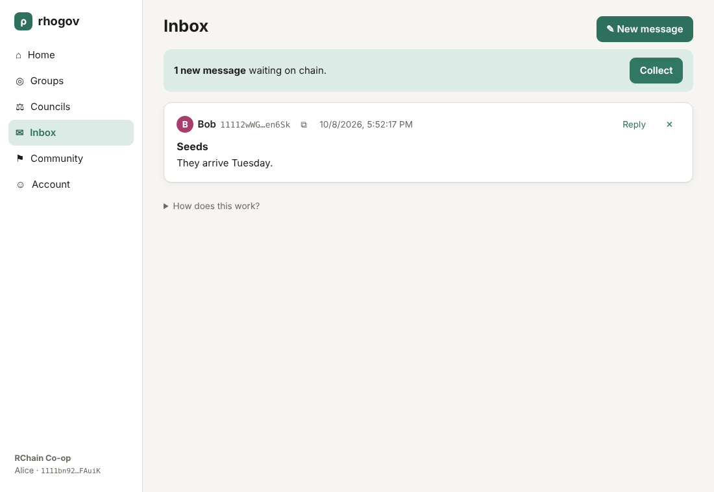

> Messages are **not encrypted**. Until you collect them they sit in the chain's
> data, where a determined person could read them. Don't send secrets.

## 9. Councils: decisions across stakeholder groups

Some decisions affect very different groups of people: users, developers,
validators, token holders. A **council** gives each of those groups its own voice
and lets everyone decide together how much weight each voice gets.

### Setting one up

Open **Councils** and press **＋ New council**. Give it a name and a short
statement of purpose (what it decides, and what it doesn't). Then pick its
**stakeholder groups**: Users, Developers, Validators, Token holders, Service
providers, Governance stewards, or your own. Invite-only groups are for
stakeholders whose standing should be checked, such as validators.

The person who creates a council is its **facilitator**. They start out as a
member of every stakeholder group, so they should **leave the ones they don't
belong to** (Stakeholder groups tab).

### Joining

On the **Stakeholder groups** tab, tick every group that describes you and press
**Join**. If you're both a developer and a token holder, join both; your ballot
then counts in each. Each stakeholder group is a normal group, with its own
members, trust, delegation and censure (**Members & trust →**).

### Voting power

How much should each stakeholder group's view count? Everyone decides. On the
**Voting power** tab, set the sliders to your estimate and submit. Each group's
power is the **middle value (median)** of everyone's estimates, so a few extreme
estimates can't swing it.

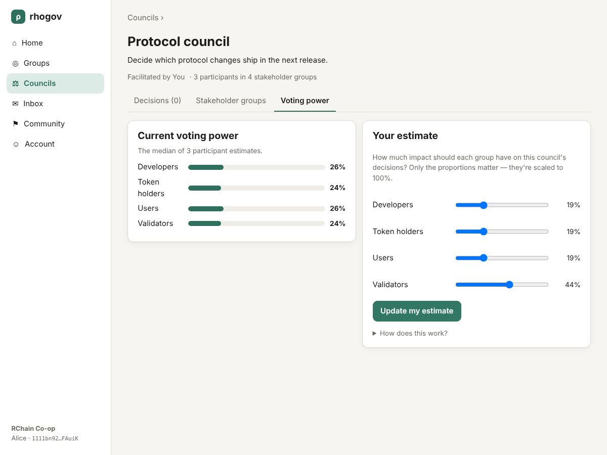

### A decision, step by step

The facilitator starts a decision with **＋ New decision**: the question, the
background (the problem and what success looks like), and the options. It then
moves through four phases:

1. **Prepare**: the facilitator frames the question and the options.
2. **Deliberate**: everyone adds the strongest **points for and against** each
   option and **👍 endorses** the points they find convincing, whichever way
   they'll vote.
3. **Decide**: the facilitator opens voting. Everyone ticks the options they
   can live with.
4. **Record & follow up**: the facilitator records the **decision of record**:
   the outcome, the reasoning, and the **action items** (who does what, by
   when). Points made against the chosen option are kept as **recorded dissent**.

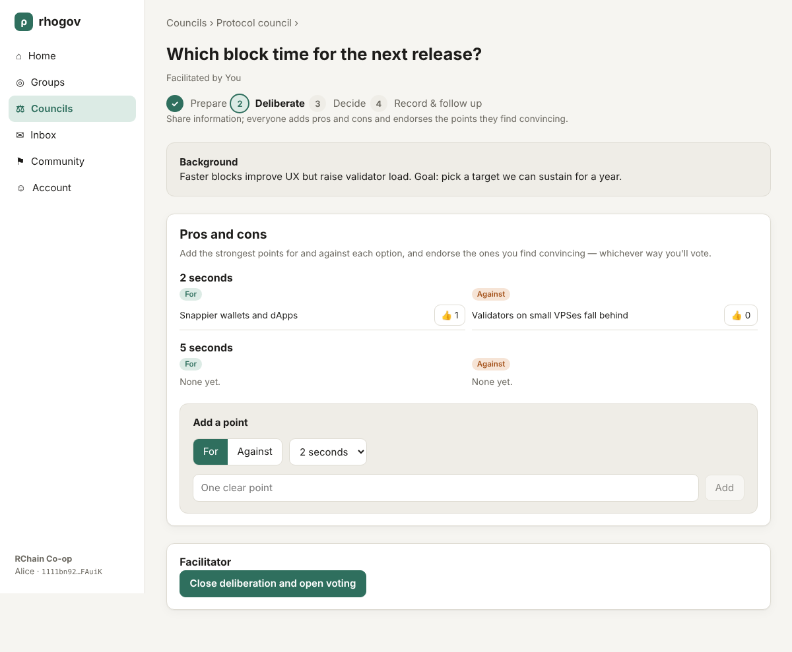

### How the result is worked out

Within each stakeholder group, the votes are weighed by *that group's own* trust
and delegation, and the node names the group's own choice. The overall score for
each option is:

> sum, over all groups, of (the group's voting power × the share of that group's
> weighted vote that approves the option)

A group that hasn't voted adds nothing, and its power isn't handed to the others.
So a missing voice shows up as missing support.

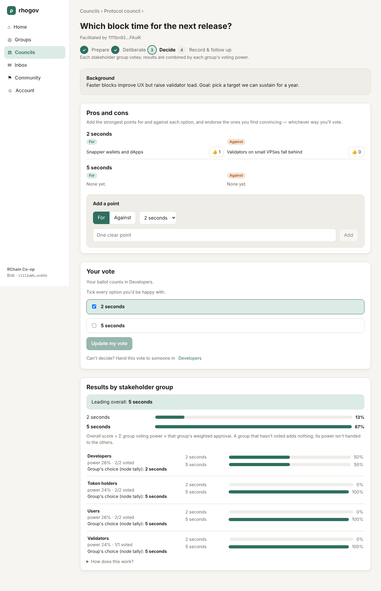

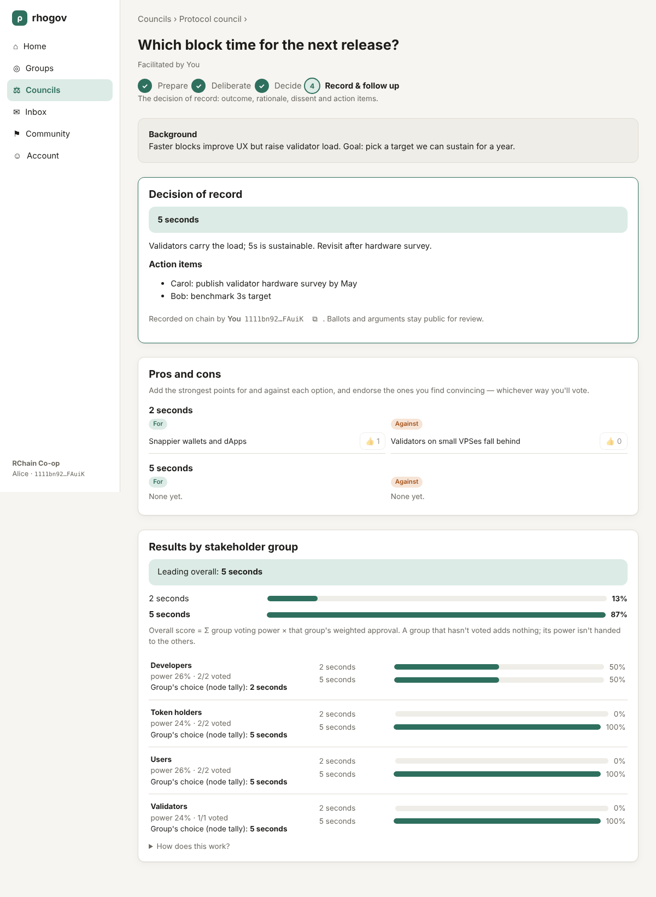

**New participants.** People who join a council after a decision opened can
read it, but can't add points, endorse or vote until the facilitator adds them.
They see "You're waiting to be added to this decision", and who adds them.

The facilitator sees them as **waiting**: on the council's list of decisions
("2 waiting to take part"), and at the top of each decision, one row per person,
with their stakeholder groups. From that row the facilitator can:

- **Add to this decision**, one person at a time, so each is approved
  individually (there's an **Add all** for when that's what you want);
- **Invite to a stakeholder group**, if they're in none yet;
- **Trust in …**, to vouch for them in a stakeholder group you share.

**Invite someone to a stakeholder group** on the same card brings in someone
new: they get a message with a link, and show as waiting once they've joined.

## 10. Your account and your key

On **Account** you can:

- change your display name. Everyone sees you by your name (never your address), and
  only your key can set it: in the chain's name directory where the network has
  one, otherwise on the community's own name list. A name must be **unique in
  the community**: if someone already has it, you're asked to pick another.
  Capitals count ("Jim" and "jim" are different names), and a name can't start
  with a number (that's how addresses start). Names that *look* the same count as
  the same: "Adα" (with a Greek α) can't sit beside "Ada", and a name can't mix
  alphabets or contain invisible characters. If two people already share a
  name, both are numbered, "(1)" and "(2)"; the numbers don't say who was first. **Your name belongs to your key**:
  sign in with the same key on another device and its name comes with it,
  whatever you typed there;
- copy your **address**: give it to people who want to invite or message you;
- check your **balance** and, on the playground or testnet, **Get test REV**;
- **Save keystore file**: your key, encrypted with a password you choose, as the
  standard JSON keystore file (Web3 Secret Storage v3, scrypt and AES) that geth,
  MetaMask and other wallets read. To use it on another browser or device, choose
  **I have a key**, pick the file and type its password. The password is checked in
  the browser; rhogov can't recover a forgotten one. A **plain-text backup** is
  there too, but it isn't encrypted. You can also show the key to paste it
  elsewhere;
- turn on **Show me the exact rholang before I sign each action**, to see precisely
  what you're signing. Anything that moves trust, membership, voting weight or money
  is shown and waits for you. Routine housekeeping — putting your name on the
  community's list, sending a message — signs without asking, so it can happen
  quietly in the background.

Your key **is** you. Anyone who has it can act as you, so keep backups private
and offline. If it's lost, that identity can't be recovered.

## 11. What is public, and what it costs

**Public, by design, and visible to anyone:**

- who belongs to which group, and their trust levels;
- who rated, delegated to and censured whom;
- every ballot (that's what makes the count verifiable);
- pros, cons, endorsements and decisions of record;
- how many inbox messages someone has (not their contents, but see the note in
  [section 8](#8-inbox)).

**Costs.** Every action is a small transaction paid in REV ("phlo" is the unit
of work). Typical actions cost a tiny fraction of the test REV the playground's
faucet gives you. Reading, browsing and seeing results are free.

**No server.** rhogov is a single web page. It talks only to the network node you
chose; there's no rhogov server, database or account.

## 12. Troubleshooting

**Help is in the menu** (bottom left; on a phone, **? Help** at the end of the bottom bar):

- **Help for you** explains the screen you're on and lists your next steps, worked
  out from where you are. For example: finish setup; your balance is too low to act;
  your name isn't claimed in the community yet; a vote needs your ballot; you joined
  after a vote opened; messages are waiting; or you're in no group yet. Each step has a
  link that takes you there.
- **User guide** is this page, and **About rhogov** is the project's README.
- **Report a problem** opens a GitHub issue for you to check and submit. It comes
  filled in with your rhogov version, network, community, address, balance, what Help
  suggested, and your recent errors. Your key is never included, and you see exactly
  what's sent before anything leaves the page.

| What you see | What to do |
|---|---|
| **"Couldn't read the chain for …"** | The card says which community and network. If the network **isn't answering**, press **Retry**, or **Change network address** if it moved (rhogov checks the community's contracts answer at the new address before switching). If the network answers but the **contracts don't** (a test network that was reset loses everything), **Forget** it or **Join or start another community**. Your other communities are one click away on the same card. |
| **"This invite link is damaged"** | Part of the link was lost, usually cut off or wrapped when pasted. Ask for a fresh link sent as one unbroken line. The page also lets you enter the community's contract addresses by hand, or start your own. |
| **"Can't reach it"** when choosing a network | Check the address. A local node needs `--api-host`. A page opened over `https://` can only reach `http://` nodes on your own computer. |
| **"Waiting for a block…"** for a long time | A card in the middle of the screen shows each action in progress, with how long it has waited; you can keep using the app meanwhile. The network is busy or idle. It usually finishes within a minute; rhogov keeps checking for up to 15. **Don't repeat the action while it waits**: it could happen twice (pressing the same button again just points you at the card). |
| **"It hasn't appeared in a block after 15 minutes"** | The network is stalled and the action may still land later, so don't repeat it yet. If it was starting a community, the setup screen remembers it and offers **Look for “name”**, which checks for that one instead of installing (and paying for) a second set. |
| **"The node didn't confirm it…"** | The node refused without a reason, which sometimes means it was carried anyway. rhogov watches for it for 2 minutes: if it lands, it finishes normally; if not, it tells you it was not carried, nothing was charged, and trying again is safe. |
| **"…failed, so nothing changed; its fee was still charged"** | The action ran in a block and was rejected. A failed action still costs its fee, like any other. |
| **"Couldn't finish: …"** | The card stays until you close it, and says what went wrong and what to do. You can drag either card out of the way; double-click puts it back in the middle. |
| **A balance of 0**, **Start community** greyed out, or "Not enough REV" | On the playground or testnet, press **Get test REV** on Account (on the testnet, [r-wallet](https://rhowallet.org)'s faucet works too). Elsewhere, ask someone to send you REV. |
| **"This group is invite-only…"** | Ask one of its admins to invite you, by your name or your address from Account. |
| **"No one in your communities is called …"** | Check the spelling (capitals count), or ask for their REV address and paste that instead. People are found by name across all the communities you've joined on that network, once they have a name. |
| **"This vote isn't open to you"** | You joined after the vote opened. Ask whoever opened it to add you. |
| **"No name yet"** | That person hasn't set a name, or hasn't had the REV for the one small deploy it takes; their name appears once they do. Every person's address is one click away with the ⧉ copy button beside their name. |
| **"Jim (unclaimed)"** or **"Jim (2)"** | Someone else claimed that name in this community. *(unclaimed)* marks a name only typed when joining a group; *(2)* marks a second claim made at the same moment. |
| **"“Name” is taken"** | Someone else in this community already uses that name. Choose another on **Account**. |
| **"A new version of rhogov is available"** | A newer rhogov was published while your page was open. Press **Reload** (nothing you've done is lost), or **Later**. The version you're running is shown at the bottom of the menu. |
| **Something looks out of date** | rhogov re-reads every 15 seconds; your own actions show up straight away. Reloading the page also works. |

## 13. Glossary

- **Address**: your public identifier on the network (starts with `1111`), safe to
  share.
- **Key**: the secret that signs your actions. Never share it.
- **REV / phlo**: the network's currency, and the unit that measures how much
  work an action takes.
- **Community**: everyone using one set of governance contracts.
- **Group**: people who vote together.
- **Delegate**: the person who carries your vote when you don't vote.
- **Trust level**: 0–5; a vote counts for 1 + the voter's level.
- **Censure**: a vote of no confidence in someone's trust. The button says **Dispute their trust**; the
  name the contract uses is censure.
- **Council**: a body that decides across several stakeholder groups.
- **Stakeholder group**: one kind of participant in a council, with its own
  members, trust and delegation.
- **Voting power**: how much a stakeholder group's view counts, set by the median
  of everyone's estimates.
- **Facilitator**: whoever runs a council's decisions through their phases.
- **Decision of record**: the outcome, rationale, action items and dissent, saved
  on chain.
